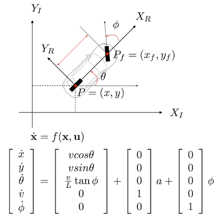
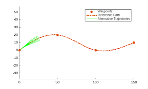

# Autonomous Vehicle Trajectory Tracking — Stanley Controller (MATLAB/Simulink)

A MATLAB/Simulink simulation of an autonomous vehicle tracking a sinusoidal reference path using the **Stanley lateral controller**, with a kinematic bicycle model and realistic steering actuator limits.

---

## Overview

The goal of this project is to make a vehicle follow a reference trajectory while correcting an initial lateral offset. The model is organized into three modular subsystems:

| Subsystem | Role |
|---|---|
| **Reference Trajectory Generator** | Produces `X_ref`, `Y_ref`, and `theta_ref` for a sine-wave path |
| **Stanley Controller** | Computes the steering command `delta_cmd` from heading and cross-track errors |
| **Vehicle Kinematics & Actuators** | Kinematic bicycle model with steering saturation and rate limiting |

---

## Vehicle Model (Kinematic Bicycle)



*(In the figure the steering angle is denoted by φ; in this project it is denoted by `delta`.)*

```
x_dot     = v * cos(theta)
y_dot     = v * sin(theta)
theta_dot = (v / L) * tan(delta)
```

where `v` is the vehicle speed, `L` the wheelbase, `theta` the heading angle, and `delta` the steering angle.

The model integrates these equations to obtain `X`, `Y`, and `theta`. The steering command passes through a **rate limiter** and a **saturation** block before reaching the vehicle, which represents the physical limits of the steering system.

---

## Stanley Controller

The steering command combines a heading-alignment term with a cross-track correction term:

```
delta = (theta_ref - theta) + atan( K * e_y / (Ks + v) )
```

- `theta_ref - theta`: heading error
- `e_y`: cross-track error relative to the reference path
- `K`: cross-track error gain
- `Ks`: softening constant that avoids aggressive steering at low speeds

---

## Reference Trajectory



A sine-wave path with amplitude `A = 5 m`, generated inside the *Reference Trajectory Generator* subsystem. The vehicle starts with a **1 m initial lateral offset** to test how well the controller converges to the path.

---

## Parameters

All parameters are defined in `parameters.m`.

| Parameter | Value | Description |
|---|---|---|
| `dt` | 0.01 s | Sample time (100 Hz) |
| `T_final` | 60 s | Simulation time |
| `L` | 2.8 m | Wheelbase |
| `v_ref` | 10 m/s | Nominal speed (36 km/h) |
| `max_steer_rad` | ±0.5236 rad | Steering limit (±30°) |
| `steer_rate_lim` | ±0.8727 rad/s | Steering rate limit (±50°/s) |
| `A` | 5 m | Path amplitude |
| `omega` | 0.05 rad/s | Path frequency |
| `K` | 0.75 | Cross-track gain |
| `Ks` | 1.0 m/s | Softening constant |
| `X_0, Y_0, theta_0` | 0, 1, 0 | Initial state (1 m lateral offset) |

---

## How to Run

1. Clone the repository:
   ```bash
   git clone https://github.com/<your-username>/stanley-trajectory-tracking-simulink.git
   ```
2. Open MATLAB and set the repository folder as the current folder.
3. Run `parameters.m` to load the parameters into the workspace.
4. Open `Autonomous_Vehicle_Trajectory_Tracking.slx` and click **Run**.
5. Inspect the **Scope** and the **XY Graph** to compare the vehicle path against the reference.

---

## Repository Structure

```
├── Autonomous_Vehicle_Trajectory_Tracking.slx   # Simulink model
├── parameters.m                                 # Parameters script
├── docs/                                        # Images used in this README
└── README.md
```

---

## Results

> Add a screenshot of the XY plot (vehicle path vs. reference) and the cross-track error scope here, e.g. `docs/results.png`, then reference it with:
> ``

---

## Requirements

- MATLAB with Simulink (R2023a or later recommended)

---

## Future Work

- Tuning `K` and `Ks` and comparing performance at different speeds
- Comparing Stanley with Pure Pursuit
- Extending to a dynamic vehicle model
- Testing on more complex paths (waypoints, curves)

---

## Author

**Mohamed Ragab**
Mechatronics & Robotics Engineering Student
Aspiring Autonomous Vehicle Engineer

Related project: [Inverted Pendulum PID Simulation](https://github.com/<your-username>/inverted-pendulum-pid-simulink)
