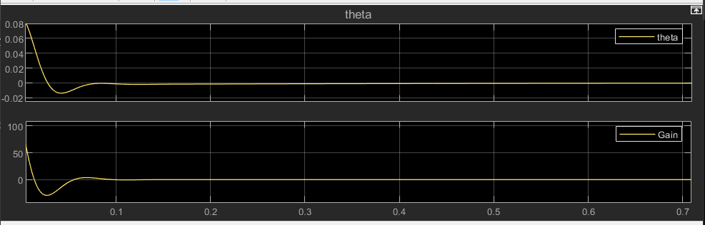

# Inverted Pendulum on a Cart - Filtered PID Control Simulation

An end-to-end MATLAB/Simulink simulation project modeling the non-linear dynamics of an Inverted Pendulum on a Cart system and stabilizing it using a Filtered PID Controller.

## 📌 Project Overview

The Inverted Pendulum is a standard benchmark problem in control theory due to its inherently open-loop unstable and non-linear dynamics. This project demonstrates dynamic modeling from first principles, PID parameter tuning, high-frequency derivative noise filtering, and system performance validation in Simulink.

## ⚙️ Controller Design

The controller is designed in the Laplace domain using a Filtered PID structure with a derivative filter coefficient ($N$):

$$C(s) = K_p + \frac{K_i}{s} + K_d \frac{N s}{s + N}$$

- **Proportional Gain ($K_p$):** Provides immediate corrective action based on error magnitude.
- **Integral Gain ($K_i$):** Eliminates steady-state error ($\theta \to 0$).
- **Derivative Gain ($K_d$) + Filter ($N$):** Improves transient response and damping while filtering high-frequency noise.

## 🏗️ System Architecture & Subsystems

The model is structured into three clean subsystems to enforce strict solver execution order:

1. `PID Controller`: Contains the Laplace-domain Filtered PID control logic.
2. `Cart & Pendulum Dynamics`: Computes the acceleration derived from the system's non-linear equations of motion.
3. `Pendulum Kinematics`: Integrates accelerations to compute angular velocity ($\dot{\theta}$) and angle ($\theta$).

## 📁 Repository Structure

- `Inverted_Pendulum_Model.slx`: Self-contained Simulink model including the top-level architecture, Model Workspace parameters, and subsystems.
- `README.md`: Project documentation and setup guide.

## 🚀 How to Run

1. Clone this repository:

   ```bash
   git clone https://github.com/mohamed983-5/AI-Engineering-Journey.git
   ```

2. Open MATLAB and navigate to the project directory.
3. Double-click to open `Inverted_Pendulum_Model.slx`.
4. Click **Run** in Simulink. Physical parameters ($M$, $m$, $l$, $b$, $g$) are embedded in the Model Workspace; the controller gains ($K_p$, $K_i$, $K_d$, $N$) are set as mask parameters on the `PID Controller` subsystem.
5. Open the **Scope** to observe the stabilization of the angle ($\theta$) and the control force ($F$).

## 📊 Simulation Results

Initial condition: pendulum tilted by $\theta_0 = 0.087$ rad (≈ 5°), reference $\theta_{ref} = 0$.



**Parameters used**

| Cart mass $M$ | Pendulum mass $m$ | Length $l$ | Friction $b$ | $K_p$ | $K_i$ | $K_d$ | $N$ |
|:---:|:---:|:---:|:---:|:---:|:---:|:---:|:---:|
| 0.5 kg | 0.2 kg | 0.3 m | 0.1 | 40 | 5 | 12 | 100 |

**Observations**

- The pendulum returns to the upright position in about 0.1 s, with a small undershoot of ≈ −0.014 rad (≈ 0.8°) at ≈ 0.035 s.
- No sustained oscillation and no steady-state error; the small residual error decays slowly because of the integral term.
- The control force peaks at ≈ 108 N at $t = 0$ and swings to ≈ −29 N before settling.

**Limitations**

- The initial force spike comes from the derivative term acting on the initial error ($K_d N \theta_0$). It is large for a 0.5 kg cart, so a real actuator would saturate. Applying the derivative to the measured angle or adding a saturation block would reduce it.

## 👤 Author

**Mohamed**  
Robotics & Mechatronics student

- GitHub: [@mohamed983-5](https://github.com/mohamed983-5)
